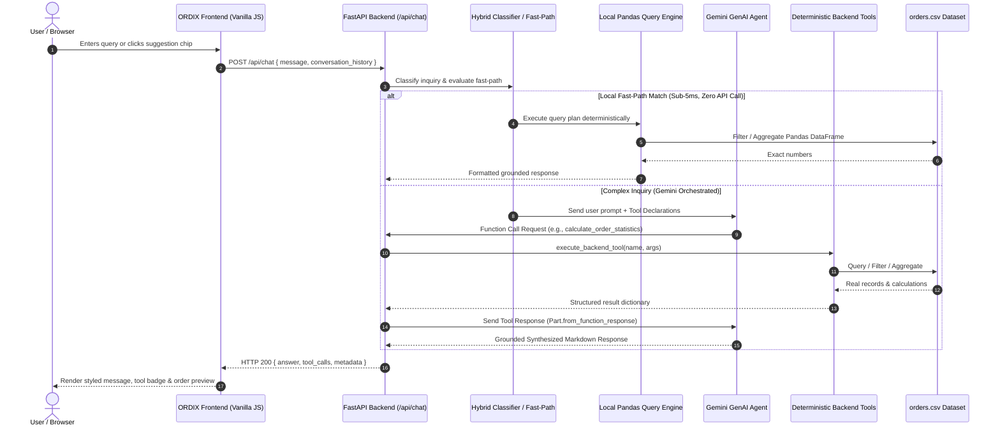

# ORDIX — Orders Simplified
### *Your AI-Powered Order Assistant*

[](https://www.python.org/)
[](https://fastapi.tiangolo.com/)
[](https://ai.google.dev/)
[](tests/)
[](LICENSE)

**ORDIX** is an enterprise-grade AI order assistant built with **FastAPI**, the official **Google Gemini GenAI SDK**, a deterministic Python/pandas analytical engine, and a modern, responsive web application. It transforms raw order datasets (`orders.csv`) into an intuitive conversational interface where operators, support teams, and executives can track shipments, analyze revenue trends, and evaluate customer performance using natural language—with **zero mathematical hallucination**.

---

## 1. Problem Statement & Proposed Solution

### The Problem
E-commerce businesses and operations teams regularly deal with order spreadsheets (`orders.csv`). Extracting insights or locating a specific customer order typically requires manual filtering, writing custom spreadsheet formulas, or requesting ad-hoc reports from data analysts. 

Generic AI chatbots often hallucinate numbers, miscalculate sums, or invent nonexistent orders because they attempt to perform mathematical aggregations in-prompt without backend grounding.

### The ORDIX Solution
ORDIX bridges natural language inquiries with **deterministic backend Python tools** and a **local pandas query engine** via Gemini's official tool/function calling mechanism:
- **Zero Hallucination Aggregations:** Calculations (gross revenue, delivered sales, monthly trends, customer lifetime value) are computed deterministically in Python using verified formulas.
- **Accurate Grounded Lookups:** Order lookups are retrieved directly from the verified `orders.csv` dataset with exact and fuzzy matching.
- **Natural Language Synthesis:** Gemini synthesizes concise, polished, actionable answers grounded strictly in the tool outputs.
- **Hybrid Intelligent Routing:** Frequently asked analytical questions and exact order lookups run through high-speed deterministic fast-paths locally in sub-5ms with **0 external API calls**.
- **Quota Resilience:** When Gemini API keys are absent or rate-limited (HTTP `429`), the local deterministic engine seamlessly answers queries without degrading user experience.

---

## 2. Key Features

- 🔍 **Real-Time Order Tracking & Search (`search_orders`):**
  - Search by Order ID (`ORD-1001`), customer name (`Sneha Pillai`), status (`delivered`, `cancelled`, `returned`, `processing`, `shipped`), product, category, city, payment method, or date range.
  - Interactive structured preview cards rendered directly inside the chat interface.
- 📊 **Deterministic Statistical Analytics (`calculate_order_statistics`):**
  - **Summary Overview:** Total orders, delivered revenue, gross order value, lost revenue from cancellations, and average order value (AOV).
  - **Order Counts by Status:** Exact distribution across all 5 order statuses.
  - **Cancelled & Pending Analysis:** Revenue lost to cancellations and volume currently processing or in transit.
  - **Monthly Revenue:** Chronological calendar-month revenue breakdowns (June, July, August, September 2026).
  - **Category Breakdown:** Sales volume and revenue by category (*Electronics*, *Furniture*, *Accessories*, *Stationery*).
  - **Customer Spending Rankings:** Identifies the highest-spending customer (*Rohan Das*), lowest spender, and customer frequency profiles.
  - **Regional Analysis:** Order volumes and revenue across cities (*Chennai*, *Kochi*, *Thiruvananthapuram*, *Bengaluru*, *Pune*, *Hyderabad*).
- ⚡ **Local Pandas Query Engine (`query_engine.py`):**
  - Multi-dimensional filtering (e.g., *orders from Kochi paid via UPI*).
  - Chronological comparisons and variance calculation between consecutive months.
  - Context-aware follow-up queries without filter leakage.
- 🎨 **Enterprise SaaS UI/UX:**
  - Curated brand aesthetic: Deep Forest Green (`#25483D`), Warm Ivory (`#F5F0E8`), Muted Amber (`#B77943`), Charcoal (`#292F2A`), and Soft Stone (`#D9D0C3`).
  - Clean typography utilizing Google Font **Inter**.
  - Interactive suggestion chips (*Track an Order*, *Cancelled Orders*, *Monthly Revenue*, *Top Customer*, etc.).
  - Safe markdown rendering with custom tables and currency formatting (`₹`).
  - Resilient error handling with retry actions and non-sensitive configuration diagnostics.
- 🛡️ **Enterprise Security & Reliability:**
  - Robust Pydantic request validation and strict size limits (max 1,000 characters per inquiry).
  - API keys strictly read from `GEMINI_API_KEY` environment variable; never exposed in logs, responses, or client code.
  - Tool execution limit (max 5 iterations) to prevent runaway loops.
  - Standard HTTP status codes: `503` for unconfigured credentials, `502` for AI provider errors, `422` for invalid payloads.

---

## 3. Technology Stack

- **Frontend:** Semantic HTML5, CSS3 Custom Properties (custom design system, zero heavyweight UI dependencies), Vanilla JavaScript (ES6+).
- **Backend API:** Python 3.12+, FastAPI, Pydantic v2, Uvicorn, Pandas, standard `csv` & `datetime`.
- **AI Agent & Function Calling:** Official Google GenAI SDK (`google-genai`).
- **Testing & QA:** Pytest, HTTPX, FastAPI TestClient (**105 automated unit and integration tests passing**).

---

## 4. Architecture & Data Flow



---

## 5. Project Structure

```
order-assistant/
├── .env.example              # Environment variables template (placeholders only)
├── .gitignore                # Git exclusions (.env, .venv, caches, secrets, IDEs)
├── orders.csv                # Verified orders dataset (60 records)
├── main.py                   # FastAPI application, REST endpoints, and lifespan
├── agent.py                  # Gemini AI Agent orchestrator & quota fallback
├── router.py                 # Fast-path query classifier and intent routing
├── tools.py                  # search_orders & calculate_order_statistics tools
├── query_engine.py           # Local Pandas Data-Query Engine (arithmetic, grouping)
├── query_planner.py          # Structured query planner (hybrid local NLP & Gemini)
├── query_plan.py             # Declarative Structured Query Plan models & validation
├── plan_executor.py          # Deterministic Python/pandas query plan executor
├── schema_inspector.py       # Dynamic CSV schema introspection & caching
├── data_loader.py            # CSV parsing, schema validation, and summary
├── pytest.ini                # Pytest configuration (pythonpath = .)
├── requirements.txt          # Python project dependencies
├── static/
│   ├── index.html            # Main web interface
│   ├── styles.css            # Custom design tokens, glassmorphism, responsive CSS
│   └── app.js                # Frontend client logic and markdown renderer
├── tests/
│   ├── test_accuracy_and_reliability.py # Ground-truth accuracy and edge-case tests (10 tests)
│   ├── test_agent.py                    # Tool dispatching, limits, and mock AI tests (5 tests)
│   ├── test_api.py                      # REST endpoints, validation, and HTTP error tests (11 tests)
│   ├── test_data_loader.py              # CSV ingestion, validation, and error tests (5 tests)
│   ├── test_general_analyst.py          # Structured planner, executor, and variance tests (20 tests)
│   ├── test_query_engine.py             # Pandas engine aggregations & follow-up tests (14 tests)
│   ├── test_router.py                   # Intent classifier fast-path & fallback tests (19 tests)
│   └── test_tools.py                    # Multi-field search and statistics tests (21 tests)
├── PROJECT_WRITEUP.md        # Comprehensive technical & executive writeup
└── README.md                 # Complete project documentation
```

---

## 6. Dataset Profile (`orders.csv` Ground Truth)

All metrics are verified against the real dataset:

| Metric | Value |
| :--- | :--- |
| **Total Orders** | 60 records |
| **Date Span** | June 1, 2026 – September 28, 2026 |
| **Gross Order Value** | ₹4,70,312.00 |
| **Net Revenue (excl. cancelled)** | ₹3,97,678.00 |
| **Delivered Orders** | 48 orders (₹3,71,040.00) |
| **Cancelled Orders** | 7 orders (₹72,634.00 lost revenue) |
| **Returned Orders** | 3 orders (₹24,292.00) |
| **Processing Orders** | 1 order (₹1,299.00) |
| **Shipped Orders** | 1 order (₹1,047.00) |
| **Product Categories** | Electronics, Accessories, Furniture, Stationery |
| **Geographic Coverage** | Bengaluru, Chennai, Hyderabad, Kochi, Pune, Thiruvananthapuram |

---

## 7. Setup & Run Instructions

### Prerequisites
- **Python:** 3.12 or newer installed (`python --version`)
- **Git:** Git installed (`git --version`)
- **Shell:** PowerShell or Command Prompt (Windows), or Bash / Zsh (Linux / macOS)

### Step 1: Clone the Repository
```bash
git clone <repository-url>
cd order-assistant
```

### Step 2: Create & Activate Virtual Environment

**On Windows (PowerShell):**
```powershell
python -m venv .venv
.\.venv\Scripts\Activate.ps1
```
*(If PowerShell restricts script execution, run `Set-ExecutionPolicy -Scope Process -ExecutionPolicy Bypass` first).*

**On Windows (Command Prompt):**
```cmd
python -m venv .venv
.venv\Scripts\activate.bat
```

**On Linux / macOS (Bash/Zsh):**
```bash
python3 -m venv .venv
source .venv/bin/activate
```

### Step 3: Install Dependencies
```bash
pip install -r requirements.txt
```

### Step 4: Configure Environment Variables
Create your local `.env` configuration file from the provided `.env.example` template:

**Windows PowerShell:**
```powershell
Copy-Item .env.example .env
```

**Windows Command Prompt:**
```cmd
copy .env.example .env
```

**Linux / macOS:**
```bash
cp .env.example .env
```

Open `.env` in any text editor and insert your Google Gemini API key:
```env
GEMINI_API_KEY=your_actual_gemini_api_key_here
GEMINI_MODEL=gemini-3.8-flash
HOST=127.0.0.1
PORT=8000
```

> **Obtaining a Gemini API Key:**
> 1. Visit [Google AI Studio](https://aistudio.google.com/app/apikey).
> 2. Sign in with your Google account.
> 3. Click **"Create API key"** and copy the generated key.
> 4. Paste it into your `.env` file as `GEMINI_API_KEY`.
>
> *(Note: The local query engine can answer many standard analytical queries even without an active Gemini API key).*

### Step 5: Start the Application
Run the FastAPI development server:
```bash
uvicorn main:app --host 127.0.0.1 --port 8000 --reload
```
*(Alternatively: `python -m uvicorn main:app --host 127.0.0.1 --port 8000 --reload`)*

Once started, open your web browser and navigate to:
👉 **[http://127.0.0.1:8000](http://127.0.0.1:8000)**

---

## 8. Running Automated Tests

ORDIX includes a comprehensive test suite of **105 automated tests** covering all layers—from low-level CSV loading and pandas aggregations to hybrid intent routing and FastAPI HTTP endpoints.

Run the entire test suite locally:
```bash
pytest -v
```

All 105 tests run locally without consuming live external API credits or requiring network connectivity:

| Test Module | Coverage Area | Tests |
| :--- | :--- | :---: |
| `tests/test_accuracy_and_reliability.py` | Ground truth accuracy, least spender, quota resilience | 10 |
| `tests/test_general_analyst.py` | Schema introspection, query planner, comparisons, variances | 20 |
| `tests/test_tools.py` | Multi-field search, status filtering, statistical operations | 21 |
| `tests/test_router.py` | Fast-path intent matching, pattern recognition, and fallbacks | 19 |
| `tests/test_query_engine.py` | Pandas monthly breakdown, payment analysis, follow-ups | 14 |
| `tests/test_api.py` | FastAPI endpoints, request validation, headers, and error codes | 11 |
| `tests/test_agent.py` | Tool dispatching, iteration limits, error handling | 5 |
| `tests/test_data_loader.py` | CSV loading, corrupt header handling, schema validation | 5 |
| **Total** | **Comprehensive Automated Coverage** | **105 Passing** |

---

## 9. Example Grounded Inquiries

- **Order Tracking:**
  - *"What is the status of order ORD-1001?"*
  - *"Find all orders placed by Sneha Pillai."*
  - *"Show orders from Kochi paid via UPI."*
- **Order Status & Cancellations:**
  - *"How many orders were cancelled and what was the total lost value?"*
  - *"Show pending and processing orders from September."*
- **Financial & Revenue Analytics:**
  - *"What was the total revenue in August 2026?"*
  - *"How much revenue did each calendar month generate?"*
  - *"Which month had the highest revenue?"*
  - *"Compare monthly revenue between August and September."*
- **Customer & Product Intelligence:**
  - *"Who is the highest-spending customer?"*
  - *"Who spent the least?"*
  - *"Which product category generated the highest revenue?"*
  - *"How many customers are from Thiruvananthapuram?"*
  - *"Who paid online?"*

---

## 10. Security & Privacy Posture

- **Secrets Isolation:** `.env` and all credential files are explicitly excluded in `.gitignore`. Only `.env.example` with non-sensitive placeholders is tracked.
- **Server-Side Key Handling:** API keys are read strictly from the server's environment variables (`GEMINI_API_KEY`) and are never sent to the browser or logged to stdout.
- **Input Sanitization:** User prompts are validated through Pydantic with strict length boundaries (max 1,000 characters) to prevent denial-of-service and injection payloads.
- **Deterministic Execution:** Calculations are executed via verified Python/pandas routines rather than raw string execution or arbitrary SQL, ensuring 0 code injection vulnerability.

---

## 11. Known Limitations & Scope

1. **Dataset Scope:** The dataset contains records between June 1, 2026 and September 28, 2026. Queries for dates outside this range will accurately report zero matches.
2. **Read-Only Intelligence:** The assistant operates in analytical and search mode. Mutation operations (e.g., cancelling an order or issuing refunds) are not performed against the source CSV.
3. **Single-Service Architecture:** In standard deployment, FastAPI simultaneously serves backend APIs and static frontend assets for streamlined local deployment.

---

## 12. License

This project is licensed under the [MIT License](LICENSE).
